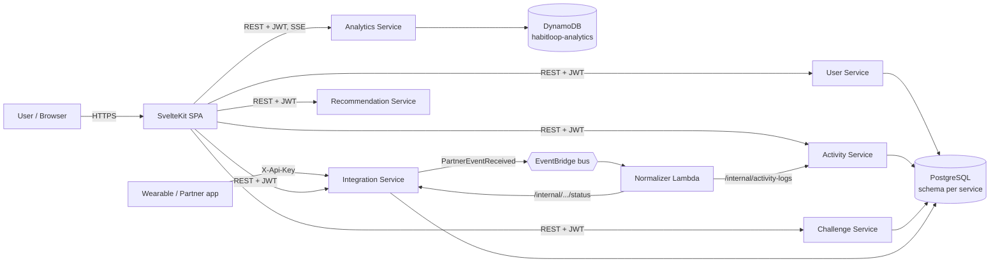
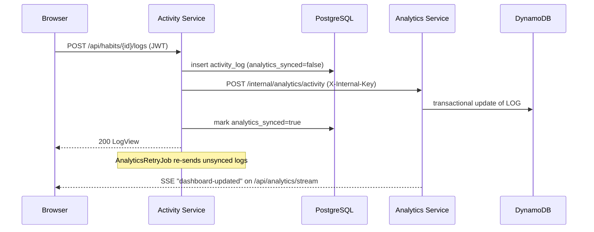
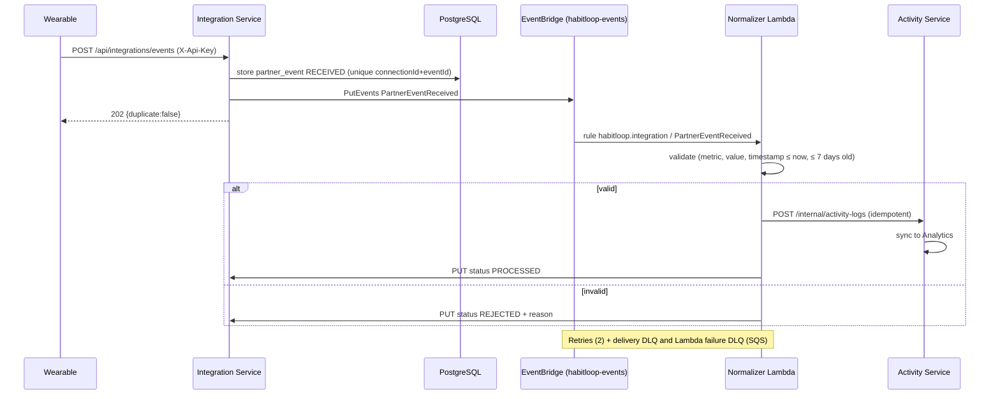
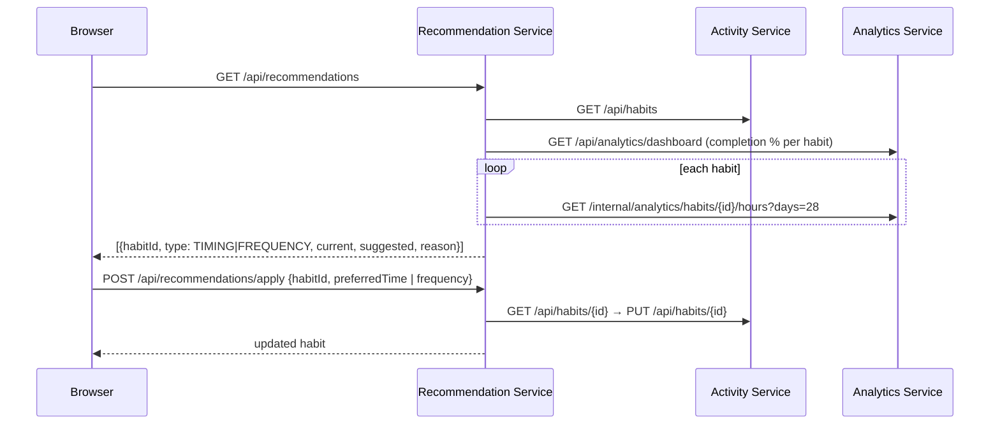

# HabitLoop — Multi-Tenant Activity Platform with External Integrations

HabitLoop is a community-oriented habit platform. Users track habits, join public or private
community challenges, connect partner devices (a mock wearable), see analytics such as streaks and
completion trends, and receive personalised **timing and frequency recommendations**.

The system is built as **six Spring Boot microservices**, a **SvelteKit + Stencil** single-page
application, and an **event-driven integration pipeline** (EventBridge + Lambda) deployed on AWS.

---

## Deliverables index

| # | Deliverable | Location |
|---|---|---|
| 1 | Public GitHub repository with source code and commits | This repository ([backend/](backend), [frontend/](frontend)) |
| 2 | Architecture overview (system design and microservice interactions) | **This README** |
| 3 | Setup guide — run locally with Docker Compose | [docs/03-setup-guide](docs/03-setup-guide/SETUP-GUIDE.md) |
| 4 | API documentation — OpenAPI spec and Postman collection | [docs/04-api-documentation](docs/04-api-documentation/README.md) |
| 5 | User walkthrough — end-to-end scenario | [docs/05-user-walkthrough](docs/05-user-walkthrough/USER-WALKTHROUGH.md) |
| 6 | Network architecture diagram (draw.io) | [docs/06-network-architecture](docs/06-network-architecture/README.md) |
| 7 | Cloud deployment documentation (screenshots) | [docs/07-cloud-deployment](docs/07-cloud-deployment/CLOUD-DEPLOYMENT.md) |
| 8 | Demo recording (cloud deployment) | [docs/08-demo-recording](docs/08-demo-recording/README.md) |

---

## 1. Repository layout

```text
.
├── README.md                     ← Architecture overview (this file)
├── backend/                      ← Java 21 / Spring Boot 3 Maven reactor
│   ├── common/                   ← Shared JWT auth filter, error handling, event normalizer
│   ├── user-service/             ← :8081  Authentication, tenants, profiles
│   ├── activity-service/         ← :8082  Habits, schedules, activity logs
│   ├── challenge-service/        ← :8083  Communities, invites, challenges, leaderboards
│   ├── integration-service/      ← :8084  Partner/wearable connections and event ingestion
│   ├── analytics-service/        ← :8085  Streaks, trends, cohorts, live updates (SSE)
│   ├── recommendation-service/   ← :8086  Timing and frequency recommendations
│   ├── integration-normalizer-lambda/ ← AWS Lambda: validates & normalises partner events
│   ├── db/                       ← PostgreSQL schema initialisation (init.sql)
│   ├── docker-compose.yml        ← Local environment
│   └── demo.http                 ← Ready-made HTTP requests
├── frontend/                     ← pnpm workspace
│   ├── apps/web/                 ← SvelteKit (Svelte 5 runes) static SPA
│   ├── packages/ui/              ← Stencil web components (hl-* widgets)
│   └── packages/api-client/      ← Typed TypeScript API client
├── scripts/publish-images.sh     ← Builds and pushes service images to Amazon ECR
└── docs/                         ← Deliverables 3–8
```

---

## 2. System context



### Services and data ownership

| Service | Port | Responsibility | Data store |
|---|---:|---|---|
| **User** | 8081 | Signup/login, JWT issuing, tenant-aware profiles, user lookup for invites | PostgreSQL `user_service` |
| **Activity** | 8082 | Habit CRUD, schedule rules (DAILY / WEEKLY + days of week + preferred time), manual and wearable activity logs | PostgreSQL `activity_service` |
| **Challenge** | 8083 | Public/private communities, invitations, challenges, participation and leaderboards | PostgreSQL `challenge_service` |
| **Integration** | 8084 | Partner catalogue, wearable connections (one-time API key), event ingestion, idempotency, publish retries | PostgreSQL `integration_service` |
| **Analytics** | 8085 | Daily counts, streaks, completion %, 30-day trend, signup-week cohorts, hourly histograms, SSE live updates | DynamoDB `habitloop-analytics` |
| **Recommendation** | 8086 | Rule-based timing window and frequency suggestions; applies an accepted suggestion to the habit | Stateless |
| **Normalizer Lambda** | — | Validates/enriches partner events and turns valid ones into activity logs | — |

Each database-backed service owns its own PostgreSQL schema; no service reads another service's
tables. Cross-service data is obtained only through REST APIs.

### Multi-tenancy and security model

- **Tenants**: every user belongs to a workspace (`public`, `acme`). The JWT carries `userId`,
  `tenantId`, `email` and `name`; every query is scoped by `tenantId` (and `userId` for
  user-owned data), so data from another workspace returns `404`.
- **User APIs** (`/api/**`) require `Authorization: Bearer <JWT>` (except signup/login).
- **Internal APIs** (`/internal/**`) require the shared `X-Internal-Key`, are reachable only on the
  private network and are never routed through the load balancer.
- **Partner ingestion** (`POST /api/integrations/events`) authenticates with a per-connection
  `X-Api-Key`, stored only as a SHA-256 hash.
- **SSE** (`/api/analytics/stream`) accepts the JWT as `?token=` because browser `EventSource`
  cannot send headers.

---

## 3. Microservice interactions

### 3.1 Synchronous call graph

| Caller | Callee | Endpoint | Why |
|---|---|---|---|
| User | Analytics | `POST /internal/analytics/users/signup` | Register user in signup-week cohort |
| Activity | Analytics | `POST /internal/analytics/activity` | Update daily counts, streaks, hourly histogram |
| Challenge | User | `GET /api/users?email=` | Resolve invitee within the same tenant |
| Challenge | Activity | `GET /api/habits/{id}` | Verify habit ownership and category on join |
| Challenge | Analytics | `GET /internal/analytics/habits/{id}/count` | Leaderboard progress inside challenge dates |
| Integration | Activity | `GET /api/habits/{id}` | Verify habit ownership when connecting a device |
| Analytics | Activity | `GET /api/habits` | Build dashboard for the user's habits |
| Recommendation | Activity | `GET /api/habits`, `GET/PUT /api/habits/{id}` | Read schedules, apply accepted suggestion |
| Recommendation | Analytics | `GET /api/analytics/dashboard`, `GET /internal/analytics/habits/{id}/hours` | Completion % and 28-day hourly histogram |
| Normalizer Lambda | Activity | `POST /internal/activity-logs` | Create a WEARABLE activity log (idempotent) |
| Normalizer Lambda | Integration | `PUT /internal/integrations/events/{id}/status` | Mark event `PROCESSED` / `REJECTED` |

### 3.2 Logging an activity (manual)



### 3.3 Partner / wearable event (event-driven)



Re-sending the same `eventId` returns `202 {duplicate:true}` without creating a second activity.
Locally (Docker Compose) the Integration Service uses a **direct publisher** that runs the same
normaliser in-process, so no AWS account is needed.

### 3.4 Recommendation Microservice



Rules (see `RecommendationRules.java`):

| Type | Condition | Suggestion |
|---|---|---|
| **TIMING** | ≥ 5 completions in last 28 days and most frequent 2-hour window ≠ preferred time window | Start of the most frequent 2-hour window (e.g. `18:00`) |
| **FREQUENCY** | DAILY habit with < 40 % completion over last 7 days | Switch to WEEKLY (Mon/Wed/Fri by default) |
| **FREQUENCY** | WEEKLY habit with > 90 % completion | Switch to DAILY |

### 3.5 Analytics data model (DynamoDB single table)

| `pk` | `sk` | Content |
|---|---|---|
| `{tenantId}#{userId}` | `DAY#{habitId}#{yyyy-mm-dd}` | Completion count per day + completion hours (hourly histogram) |
| `{tenantId}#{userId}` | `STREAK#{habitId}` | Current / longest streak, optimistic `version` |
| `{tenantId}#{userId}` | `LOG#{logId}` | Idempotency marker for processed logs |
| `{tenantId}` | `USER#{userId}` | Signup week, last active date (cohorts) |

---

## 4. Frontend design

- **SvelteKit (Svelte 5)** static SPA (`adapter-static`, SSR disabled) with routes:
  `/signup`, `/login`, `/onboarding`, `/dashboard`, `/habits`, `/habits/[id]`, `/challenges`,
  `/challenges/[id]`, `/communities/[id]`, `/invites/[id]`, `/integrations`, `/recommendations`.
- **Rune-based state** (`$state`, `$derived`, `$effect`) in `lib/state/auth.svelte.ts` and
  `lib/state/dashboard.svelte.ts`; the dashboard refreshes after every log and on SSE
  `dashboard-updated` events.
- **Stencil web components** (`packages/ui`): `hl-activity-summary`, `hl-challenge-card`,
  `hl-partner-tile`, `hl-trend-chart`, `hl-streak-badge`.
- **Typed API client** (`packages/api-client`) shared by all pages; same-origin `/api/*` calls.

---

## 5. AWS deployment architecture

Region **ap-southeast-2 (Sydney)**, two Availability Zones. See the full
[network diagram](docs/06-network-architecture/README.md).

| Layer | AWS services | Key configuration |
|---|---|---|
| Edge / frontend | **CloudFront + S3** | Private S3 bucket (Block Public Access, SSE-S3) accessed only via Origin Access Control; HTTPS redirect; SPA route rewrite function; `/api/*` behaviour forwarded to the ALB with caching disabled |
| Network | **VPC 10.20.0.0/16** | Public subnets (/24) for ALB + NAT; private *application* subnets (/20) for ECS and Lambda; isolated *data* subnets (/24) for RDS — no internet route |
| Load balancing | **Application Load Balancer** | Public, listener :80 with path rules (`/api/auth*`, `/api/habits*`, …) to six target groups, health check `/actuator/health`, default 404 |
| Compute | **ECS on Fargate** | Cluster with six services (0.25 vCPU / 512 MiB), private subnets, no public IP, Cloud Map DNS `*.habitloop.internal`, deployment circuit breaker with rollback, CPU target-tracking auto scaling (1–2 tasks, 70 %) |
| Registry | **Amazon ECR** | Six private repositories `habitloop/<service>-service`, immutable tags, scan on push, keep last 5 images |
| Data | **RDS PostgreSQL 16** (db.t4g.micro, encrypted, private) and **DynamoDB** (on-demand, encrypted) | RDS reachable only from the four DB-backed services; TLS (`sslmode=require`) |
| Events | **EventBridge + Lambda + SQS** | Custom bus `habitloop-events`; rule on `PartnerEventReceived`; Java 21 Lambda in VPC; retries + two DLQs |
| Secrets & config | **Secrets Manager** + task environment variables | DB credentials, JWT signing key and internal service key injected as ECS secrets; non-secret config (service URLs, table/bus names) as env vars |
| Identity | **IAM** | Separate task role and execution role per service; e.g. only Analytics may access the DynamoDB table and only Integration may `PutEvents` on the bus |
| Observability | **CloudWatch** | Log group per service (`/habitloop/<service>`), `HabitLoop-Demo` dashboard, alarms on 5xx, unhealthy targets, CPU, RDS, Lambda errors/throttles, EventBridge failures and DLQ depth → SNS topic |

### Security boundaries

- Separate **security group per service**; ingress only from the ALB and the services that
  actually call it (least-privilege call graph above). PostgreSQL accepts traffic only from the
  four DB-backed services.
- All tasks, Lambda and RDS run in **private subnets** without public IPs; outbound AWS API
  calls go through the NAT gateway on 443.
- **HTTPS/TLS** from the browser to CloudFront; TLS to RDS; encryption at rest for S3, RDS,
  DynamoDB and SQS.
- Secrets are never baked into images or source code.

---

## 6. Trade-offs

| Decision | Benefit | Cost |
|---|---|---|
| Database-per-service (schemas) | Independent ownership, loose coupling | Cross-service data needs API calls; no distributed transactions |
| DynamoDB for analytics | High-throughput, key-based aggregates | Eventual consistency with PostgreSQL; idempotency markers required |
| EventBridge + Lambda for partner events | Decoupled ingestion, retries, DLQs | Asynchronous status; harder debugging → CloudWatch dashboards/alarms |
| Strong network separation | Small blast radius | More security-group rules; observability becomes essential |
| Multi-tenant shared services | Lower cost, single deployment | Every query must be tenant-scoped; validated in tests |

## 7. Technology stack

Java 21 · Spring Boot 3.4 · Spring Data JPA · springdoc-openapi · PostgreSQL 16 · DynamoDB ·
AWS SDK v2 · SvelteKit 2 / Svelte 5 · Stencil · TypeScript · pnpm · Docker / Docker Compose ·
AWS (CloudFront, S3, VPC, ALB, ECS Fargate, ECR, RDS, DynamoDB, EventBridge, Lambda, SQS, SNS,
Secrets Manager, IAM, CloudWatch).
