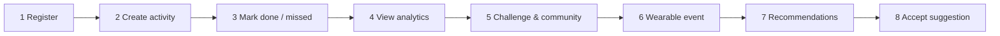

# Deliverable 5 — User Walkthrough (End-to-End Scenario)

**Persona:** *Priya*, a member of the **Acme** workspace, wants to build a daily walking habit,
join her team's walking challenge and find the best time of day to walk.

The scenario works identically on the local setup (`http://localhost:5173`) and on the cloud
deployment (`https://<cloudfront-domain>`). All times in the app are in **UTC**.

---

## Step 1 — Register

1. Open the app → **Sign up** page (`/signup`).
2. Enter *Name* `Priya Sharma`, *Email* `priya@acme.test`, *Password* (≥ 8 characters) and select
   workspace **Acme**.
3. Click **Create account →**.

**Behind the scenes:** `POST /api/auth/signup` → **User Service** creates the account in tenant
`acme`, hashes the password (BCrypt), issues a JWT and notifies **Analytics Service**
(`/internal/analytics/users/signup`) so Priya appears in the current signup-week cohort.

**Result:** Priya lands on **Onboarding**.

## Step 2 — Create an activity (habit)

On **Make this space yours**:

| Field | Value |
|---|---|
| Habit name | `Evening walk` |
| Category | `fitness` |
| Frequency | Every day (DAILY) |
| Preferred time | `07:00` UTC |

Click **Finish setup**. More habits can be added later from **My habits → Create a habit**
(DAILY, or WEEKLY with selected days, e.g. Mon/Wed/Fri).

**Behind the scenes:** `POST /api/habits` → **Activity Service** validates the schedule
(DAILY/WEEKLY, weekdays 1–7, WEEKLY requires days) and stores it in PostgreSQL
(`activity_service.habits`) scoped by tenant and user.

**Result:** The **Overview** dashboard shows *Evening walk* under **Today's habits**.

## Step 3 — Mark the activity done (and what "missed" means)

- **Done / completed:** on the dashboard card click **Log today** (the card switches to
  **Completed today**), or open **My habits → Evening walk → ✓ Log today**. The log appears under **Log history** with source `MANUAL`.
- **Missed:** a scheduled day with no log is treated as missed. Missed days lower the 7-day
  **completion %** and reset the **streak** — no extra action is needed.

**Behind the scenes:** `POST /api/habits/{id}/logs` → **Activity Service** saves the log, then
calls **Analytics Service** (`/internal/analytics/activity`), which updates DynamoDB (day count,
completion hour, streak) in a single idempotent transaction. If Analytics is temporarily down,
a retry job re-sends the log every 30 s.

**Result:** The card shows **done today**, streak **1**, and the completion % updates. Any other
open dashboard tab refreshes automatically via **Server-Sent Events** (`dashboard-updated`).

## Step 4 — View analytics

On **Overview**:

| Widget | Shows | Source |
|---|---|---|
| Today's check-ins / Habits on track | Done today, habits ≥ 70 % this week | `GET /api/analytics/dashboard` |
| Activity summary cards (`hl-activity-summary`) | Streak badge, completion % | Analytics (DynamoDB) |
| **Activity trend** (`hl-trend-chart`) | Daily completions for the last 30 days | `GET /api/analytics/habits/{id}/trend?days=30` |
| **Growing together** | Signup-week cohorts and % active in last 7 days | `GET /api/analytics/cohorts` |

## Step 5 — Join a community challenge

1. Go to **Challenges** → **+ New community** → name `Acme Walkers`, visibility **Public** →
   **Create community** (Priya becomes OWNER).
2. Open the community → fill in challenge **Walk 5 times**, category `fitness`, target `5`,
   dates covering today → **Create challenge**.
3. Open the challenge → **Choose a matching habit** → *Evening walk* → **Join this challenge**.
4. *(Optional)* **Invite someone to this challenge** → enter a colleague's email (already
   registered in Acme) → **Create invite link** → **Copy link**. The colleague opens the link (or
   sees it under **Community invites**), clicks **Accept**, then joins with their own `fitness` habit.

**Behind the scenes:** **Challenge Service** verifies membership/ownership, calls **Activity
Service** to confirm the habit belongs to Priya and its category matches, and builds the
**Leaderboard** from **Analytics Service** counts within the challenge dates.

## Step 6 — Connect a wearable and send an event

1. Go to **Integrations** → choose habit *Evening walk* → **Connect** on the **Mock Wearable** tile.
   A one-time API key is shown — copy it privately (only its hash is stored).
2. Click **Send valid event** → the event appears in history as `RECEIVED`, then `PROCESSED`, and
   a `WEARABLE` log is added to the habit.
3. Click **Resend last event** → acknowledged as **duplicate**; no second log is created.
4. Click **Send invalid event** (unsupported metric) → status `REJECTED` with reason *Unsupported metric*.

**Behind the scenes (AWS):** Integration Service stores the event in PostgreSQL and publishes
`PartnerEventReceived` to the **EventBridge** bus `habitloop-events`. The rule invokes the
**Normalizer Lambda**, which validates the event and calls Activity Service
(`/internal/activity-logs`) and Integration Service (`/internal/integrations/events/{id}/status`).
Failures are retried twice and then land in an **SQS dead-letter queue**.

## Step 7 — Visit the Recommendations page

Open **Recommendations**. For each habit the **Recommendation Service** combines:

- the habit schedule (Activity Service),
- the 7-day completion % (Analytics dashboard),
- a 28-day histogram of completion hours (Analytics internal API).

Priya sees cards such as:

| Type | Current | Suggested | Reason |
|---|---|---|---|
| **TIMING** | `07:00` | `18:00` | Most recorded completions occur in this two-hour window. |
| **FREQUENCY** | DAILY | WEEKLY | The habit was completed on fewer than 40 % of the last seven days. |

> **Tip to reproduce the timing card quickly:** the habit's preferred time is `07:00`, so log
> *Evening walk* **five times** at the current time (any UTC hour outside 06:00–07:59). The
> Recommendation Service then sees ≥ 5 completions concentrated in a different 2-hour window.
> A new DAILY habit completed on only 1–2 of the last 7 days also produces the FREQUENCY card.
> With no data the page shows *"There aren't any schedule suggestions yet…"*.

## Step 8 — Accept the personalised timing recommendation

1. On the **TIMING** card click **Apply suggestion →**.
2. (For a WEEKLY frequency card, first pick days in **Choose weekly days before applying**.)
3. Open **My habits → Evening walk** — **Preferred time** is now `18:00`.

**Behind the scenes:** `POST /api/recommendations/apply {habitId, preferredTime: "18:00"}` →
Recommendation Service reads the current habit and issues `PUT /api/habits/{id}` to the
Activity Service with only the preferred time changed. The timing card disappears because the
preferred time now matches the most active window.

---

## Summary of service interactions in this scenario

| Step | Frontend route | Services involved |
|---|---|---|
| 1 Register | `/signup` | User → Analytics |
| 2 Create activity | `/onboarding`, `/habits` | Activity |
| 3 Mark done | `/dashboard`, `/habits/[id]` | Activity → Analytics (DynamoDB), SSE |
| 4 Analytics | `/dashboard` | Analytics → Activity |
| 5 Challenge | `/challenges`, `/communities/[id]`, `/challenges/[id]` | Challenge → User, Activity, Analytics |
| 6 Wearable | `/integrations` | Integration → EventBridge → Lambda → Activity, Integration |
| 7–8 Recommendations | `/recommendations` | Recommendation → Activity, Analytics |
