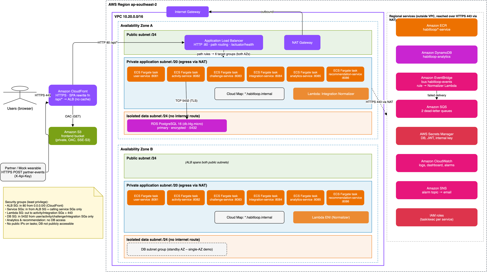
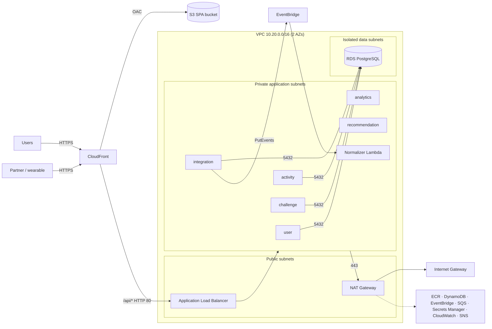

# Deliverable 6 — Network Architecture Diagram

| File | Purpose |
|---|---|
| [habitloop-network-architecture.drawio](./habitloop-network-architecture.drawio) | Editable source (open with [diagrams.net](https://app.diagrams.net) or draw.io desktop) |
| [habitloop-network-architecture.png](./habitloop-network-architecture.png) | Rendered image |

## 1. Topology

| Layer | Configuration |
|---|---|
| Region | `ap-southeast-2` (Sydney), 2 Availability Zones |
| VPC | `10.20.0.0/16`, DNS hostnames + DNS support enabled |
| Public subnets (×2, `/24`) | Application Load Balancer, NAT Gateway; route `0.0.0.0/0 → Internet Gateway` |
| Private application subnets (×2, `/20`) | ECS Fargate tasks (6 services) and the Normalizer Lambda ENIs; route `0.0.0.0/0 → NAT Gateway`; **no public IPs** |
| Isolated data subnets (×2, `/24`) | RDS PostgreSQL subnet group; **no route to the internet** |
| Edge | CloudFront (HTTPS) → S3 (Origin Access Control) for the SPA, `/api/*` → ALB |
| Service discovery | AWS Cloud Map private DNS namespace `habitloop.internal` (e.g. `activity.habitloop.internal:8082`) |
| Regional services | ECR, DynamoDB, EventBridge, SQS, Secrets Manager, CloudWatch, SNS — reached over HTTPS 443 through the NAT Gateway |

> A single NAT Gateway is used to keep the demo cost low. For production, one NAT Gateway per AZ
> (and VPC endpoints for DynamoDB/S3/ECR/Secrets Manager) removes the cross-AZ dependency.

## 2. Traffic flows

| # | Flow | Path | Protocol / port |
|---|---|---|---|
| 1 | Browser loads SPA | User → CloudFront → S3 (OAC, signed SigV4) | HTTPS 443 |
| 2 | Browser calls API | User → CloudFront `/api/*` (no caching) → ALB → target group → Fargate task | HTTPS 443 → HTTP 80 → 8081–8086 |
| 3 | Live dashboard | Same as 2, long-lived SSE connection `/api/analytics/stream` | HTTPS / HTTP |
| 4 | Service-to-service | Fargate task → Cloud Map DNS → target task (private IPs only) | HTTP 8081–8086 + `X-Internal-Key` |
| 5 | Relational data | user/activity/challenge/integration tasks → RDS | TCP 5432 (TLS required) |
| 6 | Analytics data | analytics task → DynamoDB | HTTPS 443 via NAT |
| 7 | Partner events | Partner → CloudFront → ALB → integration-service → EventBridge → Normalizer Lambda → activity/integration services | HTTPS / HTTP |
| 8 | Failures | EventBridge delivery failure / Lambda failure → SQS dead-letter queues → CloudWatch alarm → SNS email | — |

## 3. Security groups (least privilege)

| Security group | Inbound | Outbound |
|---|---|---|
| **ALB SG** | TCP 80 from `0.0.0.0/0` (CloudFront origin) | Service ports to each service SG |
| **user-service SG** | 8081 from ALB SG, challenge SG | 5432 → DB SG, 8085 → analytics SG, 443 |
| **activity-service SG** | 8082 from ALB SG, challenge, integration, analytics, recommendation, Lambda SGs | 5432 → DB SG, 8085 → analytics SG, 443 |
| **challenge-service SG** | 8083 from ALB SG | 5432 → DB SG, 8081/8082/8085 → user/activity/analytics SGs, 443 |
| **integration-service SG** | 8084 from ALB SG, Lambda SG | 5432 → DB SG, 8082 → activity SG, 443 (EventBridge) |
| **analytics-service SG** | 8085 from ALB SG, user, activity, challenge, recommendation SGs | 8082 → activity SG, 443 (DynamoDB) |
| **recommendation-service SG** | 8086 from ALB SG | 8082/8085 → activity/analytics SGs, 443 |
| **Normalizer Lambda SG** | — | 8082 → activity SG, 8084 → integration SG, 443 (Secrets Manager) |
| **Database SG** | 5432 from user, activity, challenge, integration SGs and the schema-initialisation task only | — |

Network ACLs are left at the VPC defaults (stateless allow); isolation is enforced by subnet
route tables (data subnets have no internet route) and the stateful security groups above.
The default security group of the VPC has all rules removed.

## 4. Other network-level security controls

- RDS: `publiclyAccessible = false`, encrypted at rest, TLS enforced by the JDBC URL (`sslmode=require`).
- S3: Block Public Access on all four settings, bucket policy only allows CloudFront (OAC), TLS-only.
- CloudFront: HTTP → HTTPS redirect for the site; API behaviour forwards all viewer headers except `Host`, caching disabled.
- Fargate tasks have no public IPs and pull images from ECR through the NAT Gateway.
- Secrets (DB credentials, JWT signing key, internal service key) are injected from Secrets Manager at task start — never stored in images or environment files.

## 5. Text version of the diagram

